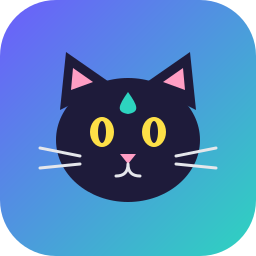

 

# DistillCat 🐱

Sends a library of prewritten prompts (HTML frontend, CSS design, JS backend, Python, logic, bug fixing) to **chat.deepseek.com** one by one, and saves the **question, thinking process and answer** into one `.jsonl` dataset.

## Setup
```powershell
python -m pip install -r requirements.txt
```
No Playwright browser download is needed: DistillCat uses your installed Chrome (or Edge with `--browser msedge`).

## Usage
Recommended: let DistillCat open your installed Chrome itself (own profile, log in once):
```powershell
python -m distillcat --browser chrome login
python -m distillcat --browser chrome diagnose     # test one tiny prompt first
python -m distillcat --browser chrome run --limit 3
```
Use the same `--browser` value every time: Chrome, Edge and bundled Chromium each keep their own login.

Experimental: attach to a browser you started with `launch` (some Chrome versions, e.g. 156, answer
the debug port with 404 and refuse to be attached, in which case use the mode above):
```powershell
python -m distillcat launch
python -m distillcat --attach run --limit 3
```
## Custom mode (your own prompts)
```powershell
python -m distillcat add                                  # opens my_prompts.txt in Notepad: one prompt per line, save, close
python -m distillcat add "Write a Rust hello world"       # or add a single prompt straight from the command line
python -m distillcat --browser chrome run --custom-only   # run ONLY your prompts
python -m distillcat --browser chrome run --custom my_prompts.txt     # built-ins + yours
```
`my_prompts.txt`: one prompt per line, lines starting with `#` are ignored, write `\n` for a line
break inside a prompt. `.jsonl` files (`{"category": "...", "prompt": "..."}` per line) also work
with `--custom`. Ids are derived from the prompt text, so
resuming works even if you edit or reorder the file.

Other options:
```powershell
python -m distillcat list                  # show categories
python -m distillcat --attach run --categories python logic --limit 5
python -m distillcat --attach run --custom my_prompts.txt --no-thinking
```
> Attach mode opens its own tab in that browser and leaves it running afterwards.
> Chrome 136+ refuses remote debugging on your *default* profile, so `launch` uses a dedicated
> profile folder (`browser_profile`). Your login there is remembered, but your normal bookmarks and
> extensions aren't. This is a Chrome security restriction that DistillCat doesn't work around.
- Runs are **resumable**: prompt ids already in the output file are skipped.
- Each prompt uses a **fresh chat**, so samples don't contaminate each other.
- `--custom` accepts `.txt` (one prompt per line) or `.jsonl` (`{"category":..., "prompt":...}`).
- Add your own built-in prompts in `distillcat/prompts.py`.

## Output format (one JSON object per line)
```json
{"id":"python-003","category":"python","question":"...","thinking":"...","output":"...",
 "source":"chat.deepseek.com","deepthink":true,"timestamp":"2026-10-30T16:00:00+00:00"}
```

## If extraction breaks
DeepSeek's web UI changes. CSS selectors live in `distillcat/selectors.json`
(`input`, `think_container`, `response`, ...). Update them using the browser's DevTools.

## Notes
- You log in yourself; DistillCat never bypasses login, captchas or rate limits (it pauses and waits for you).
- Keep delays reasonable. Check DeepSeek's Terms of Use for automated access and for how
  you may use outputs. The official API (`deepseek-reasoner`, returns `reasoning_content`) is
  the more reliable and sanctioned route for bulk collection.
